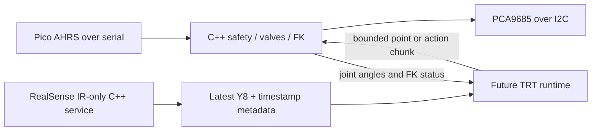

# Design and research decisions

Baseline inspected: local `kaivuriprokkis` commit `78eaf1c`. This work does not replace its launch paths. No Jetson work is performed today; all validation is on Spark.

## Why C++ here

The existing VLA integration creates the full `ExcavatorController`, imports Numba/IK, and warms FK/Jacobian/metrics even for direct valve control. The camera code expands every gray frame to RGB and supplies host timestamps instead of retaining device metadata. Import/runtime scope and buffer ownership are better targets than translating all Python line for line.

C++17 fits this small service and the SDK's native API, and keeps the control loop free of Python's interpreter and JIT. Rust would offer stronger memory-safety guarantees, but RealSense still needs native FFI and careful frame ownership. Neither language reduces TRT weight storage by itself. Keeping the models in a separate process is the larger stability decision.

Configuration is parsed once using yaml-cpp. The control loop uses fixed arrays, nonblocking bounded serial/socket reads, no periodic file logging, and one PWM burst per tick. FK runs on status requests. This avoids IK, Jacobian/SVD, recorder, controller UI, and inference dependencies. Normal scheduling is the default; CPU pinning, `SCHED_FIFO`, and memory locking are opt-in tools for later measured tuning.

## What is preserved

- Existing Jetson YAML profiles supply valve channel order, direction, midpoint/center, deadzone, asymmetric deadband, gamma, dither, optional ramps, pump pulse, IMU mapping/mounting offsets, extraction rules, and FK geometry.
- Four joint commands remain `[slew, boom, arm, bucket]`; optional tracks occupy positions 4 and 5. Extra valves stay centered.
- Quaternions use `[w,x,y,z]`. Mounting correction right-multiplies the inverse offset; slew uses relative twist and the other joints use gravity pitch differences. FK translates to each joint before applying its rotation.
- PWM counts deliberately follow the existing `int(pulse / period * 4095)` conversion and the existing prescale truncation. Pulse widths still need an oscilloscope check: physical frequency follows the chip oscillator/prescale, not exactly the nominal number.
- Pico AHRS/calibration remain on the MCU. Both 7-float legacy packets and current 10-float packets are supported, including checksum validation and 32-bit device timestamp rollover.

## Safety behavior in this version

| Event | Response |
| --- | --- |
| Boot / explicit disarm / released deadman | Calibrated valve centers, pump minimum; no motion authorization retained |
| Arm request | Valid IMUs and centered commands held for 250 ms; pump stays off during arming |
| Valid drive | Current owner only, finite normalized controls in `[-1,1]`; masked slew/tracks unless explicitly enabled |
| Producer lease exceeds 500 ms, or action chunk ends | Pump minimum immediately; valve commands decay over 250 ms; then a latched fault |
| Owner disconnect, emergency stop, bad/replayed owner packet | Immediate latched fault and neutral output on the current control tick |
| IMU stale for 100 ms, bad quaternion, MCU reset/calibration event, serial I/O error | Latched fault; rearming requires explicit disarm plus healthy data |
| CAL_WAIT / firmware errors / rejected calibration | IMUs stay unhealthy even if data follows in the same read; accepted calibration report clears the firmware block |
| Observation used by a plan exceeds 1.5 s | Immediate latched fault, including while the accepted plan is executing |
| More than 40 ms between control loop iterations | Latched deadline fault on resumption |
| SIGINT/SIGTERM / ordinary exception | Best-effort calibrated neutral and pump minimum |

The timeout path retains the old idea of reducing stale valve commands to zero, but faults now require explicit rearming. Deadman release, IMU faults, and disconnections use immediate centering. Pump stop is the configured minimum pulse (1000 us in the current profiles), not a claim that an external contactor has physically opened. Dither/ramp are bypassed for neutral/fault states.

The command-owner socket has mode 0600, checks peer UID, limits clients and packets per tick, and rejects duplicate sequence numbers. An advisory native-controller lock prevents two instances under the same UID. Serial uses `TIOCEXCL`. These do **not** stop an already running legacy controller or a process under another UID from writing the same I2C device. Hardware sessions must have one actuator owner.

This is not a hard-real-time guarantee. A blocked kernel/I2C call, OOM kill, power loss, or controller `SIGKILL` can prevent neutral writes. The chip retains outputs. A MCU/hardware watchdog controlling pump enable and/or PCA9685 OE is the next safety improvement; neither C++ nor a Linux service supervisor closes that gap on its own. No firmware or electrical changes are made in this phase.

This service does not add joint-limit avoidance, collision checks, gamepad interpretation, or model/action semantic validation. Direct valve mode must receive correctly normalized valve commands; EE/joint-position model outputs require conversion outside this service. The existing operator/task-switch supervision must be rebuilt by the future producer, which sends disarm before switching control/task.

## Camera choices

The camera process directly opens one native sensor profile per serial number, rather than opening a full pipeline. It selects Y8 IR1 or IR2; does not open depth/RGB/camera IMU; disables the emitter if supported; and requests a one-frame SDK queue. Capture is independent of the control process.

At 640×480×30, one Y8 stream carries 9.216 MB/s of pixel data; two carry 18.432 MB/s, before USB overhead. Each mapped latest-frame store is 307,200 pixel bytes plus a 4096-byte header, about 0.297 MiB per camera. This deliberately retains one frame, not a history. There is one bounded copy from the SDK frame to shared storage and one copy into a consumer buffer. RGB expansion or resize belongs in the future runtime and should happen only for selected inference frames.

A robust process-shared mutex makes metadata and pixels coherent on ARM as well as x86. Both sides use `trylock`; capture drops a frame if the reader is busy rather than waiting. No unbounded queues are created. A dead reader cannot permanently wedge the producer. After a camera restart, consumers must reopen the path; old mappings remain readable but become stale. Use the native reader library instead of reading the mutex/layout with Python directly.

The beta contains timestamp fixes and new GPU frame/device-time APIs. The current build has CUDA disabled: GPU zero-copy is a possible later experiment, not an implemented TRT path. Keeping the first capture service free of a GPU context makes the memory baseline easier to assess. See the [v2.58.4 release](https://github.com/realsenseai/librealsense/releases/tag/v2.58.4) and [SDK frame lifetime guidance](https://github.com/realsenseai/librealsense/blob/v2.58.4/doc/frame_lifetime.md).

### Timestamp contract

| Field | Meaning |
| --- | --- |
| `sensor_timestamp_us` | Device-calculated middle of sensor exposure; microseconds |
| `frame_timestamp_us` | Device readout/transmission start; microseconds |
| `sdk_timestamp_ms`, `timestamp_domain` | SDK timestamp and its declared clock domain; milliseconds |
| `host_monotonic_ns` | Local callback arrival on `CLOCK_MONOTONIC`; nanoseconds |
| `frame_counter`, `actual_exposure_us`, `gain_level` | Raw per-frame metadata, with validity bits |

These meanings come from the [SDK frame header](https://github.com/realsenseai/librealsense/blob/v2.58.4/include/librealsense2/h/rs_frame.h). `GLOBAL_TIME` maps the camera clock into OS system time; it is not monotonic time. Raw device metadata is preserved separately. Do not subtract a camera device timestamp from Pico time or host monotonic time. Exposure-to-IMU correlation needs explicit clock calibration and handling of wraps/restarts; that mapper is not built yet.

Required sensor and frame timestamps are checked per real frame. The service fails if they are unavailable; `--allow-missing-metadata` is an explicit diagnostic escape hatch. The RSUSB metadata path and requested IR-only profiles must be verified on the actual firmware/JetPack combination before deciding whether a kernel backend is necessary.

For global-shutter IR, D435/D435i are suitable candidates; D415 uses rolling shutters. Confirm the actual SKU using the [manufacturer comparison](https://www.realsenseai.com/compare-depth-cameras/) and [D435 capture guide](https://dev.realsenseai.com/docs/high-speed-capture-mode-of-intel-realsense-depth-camera-d435/). The SDK release lists firmware 5.17.3.10 or later for D435/D435i; record the installed version first, rather than automatically updating it.

Two devices are selected by their own serials and captured independently. Optional sync modes are exposed, but cable-driven simultaneous exposure is not yet verified with IR-only streaming. Matching frame numbers do not establish a shared epoch. Verify the intended setup with a visible timing event and drift logging before treating two camera clocks as interchangeable. See the [official multi-camera whitepaper](https://dev.realsenseai.com/download/18385/).
