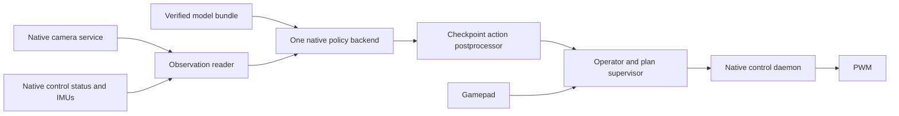

# Native LeRobot model integration plan

2026-10-26. Target: retain native OpenPI pi0.5 and add accelerated X-VLA, EVO1 and GR00T N1.7 to the native excavator stack. LeRobot pi0.5 is excluded. SmolVLA needs no new integration in this project. GR00T N1.6 is an optional NVIDIA backend, outside the LeRobot 0.6.1 compatibility target.

This is a moderate integration for X-VLA and a larger export/runtime project for the complete set. Keep C++ control, camera capture and inference as the final architecture. Reuse the split TensorRT engines and AOT kernels from `jetson-orin-nano-vla`, with checkpoint-specific processor contracts from the Python stack. Budget approximately **5–9 engineer weeks** for all three new families, including operator controls and board validation; a first usable native X-VLA path is approximately **7–12 working days**. These estimates exclude dataset collection, model training and hydraulic task-quality tuning.

GR00T is now the user's preferred early experiment because of its model capacity and board performance. Run its checkpoint/export compatibility spike before committing to the X-VLA-first implementation order. The first collection task is scooping sand and dumping it into a container. Preserve instruction text per episode and support prompt experiments; no single phrase is a deployment requirement.

## Inspected versions

| Repository | Revision | Role |
| --- | --- | --- |
| `kaivuriprokkis` on pikkumasi2tb | `964fa6da65aca50ff4842b3318bb3a0981d49be0` | Current native `main` |
| `kaivuriprokkis`, `origin/python` | `22163d2200cb5ae16310957e8f28fa1cf4a608d3` | Frozen Python behavior and processor integration |
| `jetson-orin-nano-vla` | `6e2d857ca5e3342fb2e29afd0cb60e295c10cdf5` | Fresh clone at `~/jetson-orin-nano-vla` on the board |
| LeRobot `v0.6.1` | `7e241bd630a3719a56157a497ce5d08f244784f1` | Policy and processor reference |
| Board `spark-projects` | `379dc3f` | Existing export/training project; extend here |

Board: L4T R39.2.1, CUDA runtime 13.2.86, TensorRT 10.16.2.10, 7.4 GiB usable RAM. Portable bundles and board-built caches already exist under `~/vla-clean-install-20261012/{bundles,runs}`. The fresh demo clone has no runtime environment or newly built engines.

## What can be reused

`kaivuri-control` already owns PWM and accepts timestamped action plans over KVR1 IPC. `kaivuri-camera` publishes coherent latest Y8 frames independently. Neither needs model dependencies. The separate native OpenPI executable already demonstrates TensorRT deserialization, shared device scratch, refitting, device buffers, CUDA graphs and fixture parity.

`pi05_policy.cpp` contains broadly reusable `PlanSupervisor`, `ControlLink` and threaded `Producer` machinery, despite its namespace. Renewals run every 100 ms independently of inference and preserve the original plan and observation times. Its OpenPI quantile normalization and discrete state prompt remain specific to OpenPI.

The Python branch supplies behavior worth preserving: one bundle selects one model, FPS/tasks/state semantics come from that bundle, checkpoint statistics travel with it, base-model actions cannot reach valves, A switches manual/policy control, D-pad changes task, optional track columns remain visible in logs even when disabled. The native inference executable currently has a fixed task and no equivalent operator loop. The Python inference loop polls takeover between inference calls; the native replacement should handle it independently of GPU inference.

## Model scope and difficulty

The retained board `runs/<model>/benchmark.json` records below all report `status=ok` and fixture `PASS`. They are existing synthetic base/LIBERO runs, not new measurements or evidence of excavation quality.

| Model | Board p50 / p99 | Native integration | Main extra work |
| --- | --- | --- | --- |
| OpenPI pi0.5 | Existing native smoke fine-tune documented at 434.0 / 437.5 ms | Retain | Regression coverage during extraction of shared code |
| X-VLA | 354.14 / 358.28 ms | Medium | `auto` action mode, processor boundary, AOT shape specialization |
| EVO1 | 340.41 / 348.89 ms | Medium to high | Correct padded-action masks, processor export, C++ device chain |
| GR00T N1.7 | 276.33 / 283.81 ms | High | LeRobot checkpoint bridge, embodiment processor, history, task conditioning |
| GR00T N1.6 | 273.70 / 278.69 ms | Optional | Separate NVIDIA format and embodiment support |

LeRobot 0.6.1 includes many additional policies. ACT, Diffusion, Pi0, Pi0-FAST, EO1, WALL-X and others have no corresponding export/runtime path in this demo repository. Supporting a version of LeRobot does not imply supporting every policy it contains. Add those only as separate future backends. LeRobot 0.6.1's `groot` integration supports N1.7; the demo's N1.6 support is independent.

The older Python X-VLA notes report 395 ms and 5.47 GB peak process RSS including its robot stack. The fast TensorRT path removes ORT's duplicated host weights and keeps the chain on device. Camera count, checkpoint, horizon, precision and memory accounting differ between records, so establish speed and memory gains with a matched checkpoint comparison. A C++ translation alone does not guarantee a large GPU speedup.

## Final architecture

One policy process loads one model. Switching models stops that process and releases its GPU allocations before another starts. Keep the current OpenPI invocation compatible while introducing a common `kaivuri-inference --bundle ...` entry point. Use explicit model family/schema fields for new bundles; recognize legacy bundles through narrow format adapters, rather than interpreting every `bundle.json` as X-VLA.

Proposed code boundaries:

| Area | Proposed files | Responsibility |
| --- | --- | --- |
| Common plan/control library | `include/kaivuri/policy_control.hpp`, `src/policy_control.cpp` | Extract the existing producer, IPC, renewal and plan validation; preserve behavior |
| Deployment contract | `policy_bundle.hpp/.cpp` | Schema/version checks, model identity, robot metadata and physical action mapping |
| TensorRT utilities | `trt_runtime.hpp/.cpp` | Engine/cache verification, stream, shared scratch, buffers, plugin initialization and graph lifetime |
| Model backends | `policies/openpi.cpp`, `xvla.cpp`, `evo1.cpp`, `groot17.cpp` | Separate device chains, image transforms and model-specific math |
| Common runner | `inference_main.cpp`, `policy_operator.cpp` | Fresh observations, scheduling, gamepad supervision, logs and one selected backend |
| Offline preparation | `tools/prepare_policy.py`, `build_policy_cache.py` | Verify portable bundles, extract NPY fixtures/constants, prepare task artifacts and build engines serially |

These are implementation boundaries, not a requirement to rename everything at once. First wrap the existing OpenPI runtime and extract only shared machinery needed by X-VLA. Keep CUDA-free policy/control tests buildable without TensorRT. No LeRobot, Torch, ORT or Triton compiler belongs in the deployed inference loop; Python remains suitable for export and engine preparation.

## Bundle contract

Preserve upstream model metadata and add a versioned `kaivuri` deployment section. Export it from the training configuration, processor files and dataset provenance in `spark-projects`; do not infer it from tensor width. Unsupported processor steps fail explicitly.

Required fields:

- Model family, upstream/exporter revisions, checkpoint identity, graph hashes, precision and fixture identities. Keep hashes of processor state and tokenizer artifacts too.
- State feature names/order, units, real and padded widths, state-blind behavior, normalization operation order, statistics, clipping and epsilon. Native status is radians; existing angle datasets use degrees. Translate according to the recorded contract.
- Action names/order, real and padded widths, physical meaning `normalized_valve`, range, normalization/postprocessing order and training FPS. Map `[slew,lift,tilt,scoop,trackL,trackR]` to controller channels explicitly. Four-wide output adds zero tracks. EE/joint-position policies require a separately validated controller adapter and are excluded from direct valve driving.
- Camera feature-to-slot mapping, serial/IR index, orientation, raw dimensions, image transform and padded/missing-view convention. Extend camera provenance/metadata so orientation can be checked automatically; the current frame ABI does not expose it.
- Ordered tasks with precomputed token IDs/masks and model-specific prompt artifacts; horizon, denoising schedule, noise distribution, domain/embodiment and temporal observation requirements.
- Profile/calibration identity and deployment capability. A trained LIBERO head, or an upstream `deployable=true`, is insufficient to establish excavator compatibility.

Retain separate gates for engine parity and the complete physical pipeline. Fixtures must include raw camera images, raw state, task, seeded noise, processed tensors, model output and final robot-unit output from the checkpoint's actual pre/postprocessors. Cover every configured task and both four- and six-action contracts where supported. Do not reuse OpenPI's quantile formulas for MEAN_STD or GR00T normalization.

## Implementation stages

### 1 Verify engine portability and extract shared control

Estimate: 3–5 working days.

Create a tiny C++ fixture runner for each family using the existing optimized cache and current board runtime. Prove that the serialized AOT engines deserialize and execute through C++ without Python plugin-registration glue. Existing native OpenPI is useful precedent, but does not prove every family. Verify cache identity at its existing absolute bundle path before importing it; candidate manifests contain path pins.

Extract common plan/control code, introduce the backend interface, wrap OpenPI, and run existing native tests plus OpenPI fixture parity. Keep its current numerical order and tolerances. Cache metadata must pin graph content, engine bytes, TensorRT/CUDA, SM87, accumulation, AOT specialization and builder revision. Build one graph per subprocess before control sessions.

Acceptance: native OpenPI behavior is preserved; each candidate's C++ fixture path has a clear pass or a documented deserialization blocker. Baseline TensorRT is a diagnostic fallback, with its actual performance reported separately.

### 2 Deliver native X-VLA

Estimate: 4–7 working days after stage 1; includes basic task/operator support needed for first use.

Port `XVLADevice`, reuse the older Python processor-contract logic, and support LeRobot `action_mode=auto` with no gripper sigmoid. The fast runtime currently rejects it. Normalize real state in the checkpoint's order, pad appropriately, apply its clean-action interpolation schedule, trim model padding and unnormalize actions exactly once. Preserve image normalization-before-resize and its padding convention.

Prepare task token tables offline. Generalize AOT denoiser sequence/horizon and vision-view specializations: the current recipe has sequence 262, horizon 30 and three-view depthwise-convolution kernels. Export the excavator's actual two views and horizon; benchmark native TRT first, then its valid AOT specialization. Never add a fake third physical camera to satisfy a kernel profile.

Acceptance: one real excavator fine-tune passes raw-input-to-valve parity, two fresh IR cameras work, task selection works, and the common producer accepts correctly mapped chunks with simulated control. Base `ee6d` bundles remain available for inference diagnostics only.

### 3 Deliver native EVO1

Estimate: 4–7 working days.

Port `Evo1Device`, its multimodal prompt scatter, cached context K/V and positive-time Euler integration. Preserve its uniform initial-noise distribution. Export and apply the same active-action mask as `Evo1Policy.predict_action_chunk`, including initial noise, every velocity evaluation and final output. Current demo fixtures call the action head with all dimensions enabled; that gate cannot establish equivalence to the policy for a narrower real action space.

Export the checkpoint's complete processor contract, neutral padded statistics, real action width, embodiment selection and optional postprocessing. Default valve deployments must have LIBERO gripper binarization disabled. Generalize the AOT output GEMV dimensions, currently `N=896`, `K=44800`, or report an explicit baseline-only profile.

Acceptance: compare against the public policy entry point with fewer active dimensions than the model width, not only against the existing lower-level head fixture. Preserve valid existing demo fixtures as a separate benchmark mode.

### 4 Deliver GR00T N1.7

Estimate: 7–12 working days, with checkpoint compatibility resolved first.

Teach the exporter to load a LeRobot 0.6.1 `groot` checkpoint or convert it losslessly into the pinned NVIDIA model representation. Current export dispatch recognizes NVIDIA `model_type=Gr00tN1d7`, while a LeRobot fine-tune uses its own config and wrapped state dictionary. Compare weights/config and outputs before ONNX export; never silently fall back to base weights. Derive horizon, padded widths and embodiment from the checkpoint rather than the exporter's base-profile defaults.

Serialize state/action transforms, modality order, masks and any relative-action decoding. Implement the C++ vision/backbone/DiT chain and specialize AOT shapes for the excavator's views and horizon. The benchmark clips synthetic state; real joint angles need the saved processor normalization.

Visual history is configurable, not an inherent N1.7 requirement: NVIDIA's custom-embodiment example uses two cameras with current frames only (`delta_indices=[0]`). A current-only first fine-tune is a valid training choice, but the demo's two-frame runtime and fixture path must be adapted to match. Retain raw recording so history can be evaluated later. For history-enabled checkpoints, implement a bounded timestamped buffer and convert temporal indices using the training sampling contract, independent of live camera FPS. The base profile uses `[-30,0]`; at 30 training FPS that is a one-second context lag. Validate historical-slot age separately from freshness of current cameras/IMU. Intentional old context must not masquerade as stale current input or reset its timestamp.

Current GR00T exports bake a single task into prompt-dependent artifacts. The target must accept user-supplied instruction strings, including new phrasings, rather than restricting operation to one phrase or a training-task allowlist. Expose the required prompt-dependent masks/positions/KV selections as verified runtime inputs or prepare them for arbitrary requested text before a session. A task pack is a cache optimization, not the limit of accepted instructions. Sharing token IDs alone is insufficient. Preserve the checkpoint's token capacity and explicit truncation/error behavior. Stop on task change, invalidate the previous generation, and clear/revalidate history before resuming. Fixed-prompt fixtures remain useful deterministic tests; they do not satisfy the prompt-experiment requirement by themselves.

Acceptance: LeRobot-fine-tune-to-engine parity, correct robot units, dual-camera temporal fixtures, task switches and measured memory fit with native services present. If checkpoint conversion fails, label NVIDIA-only inference as a narrower milestone.

### Initial GR00T training route

For the first excavator model, prefer NVIDIA's native N1.7 training code at a version compatible with the exporter's pinned source (`23ace64f17aa5015259b8609d371eb61a357c776`). This uses LeRobot-format data while producing the NVIDIA checkpoint representation the exporter already understands. Validate that representation with a small train-save-load-export smoke run. Keep LeRobot 0.6.1 wrapper-checkpoint compatibility as a separate integration requirement.

Record native dual-IR episodes at the existing 30 FPS, retain raw spools, full state/IMU/FK/timing and applied commands, then derive the training dataset offline. NVIDIA's pinned loader expects LeRobot v2 plus `meta/modality.json` and a custom modality configuration registered as `NEW_EMBODIMENT`. Use the existing v3-to-v2.1 conversion as a starting point and verify against the actual pinned loader. The ordinary image/state/action triples need no GR00T-specific recording format on the robot.

Start with two IR views, all meaningful joint angles (including slew when used), four direct valve outputs and tracks disabled. The exporter defaults to only lift/tilt/scoop in `observation.state`; explicitly select slew too for a slewing task. Preserve the exact prompt attached to each episode. Avoid relative-position action preprocessing: valve commands are direct values in [-1,1], so use a non-EEF absolute representation without subtracting joint angles. Hydraulic velocity/history inputs can be derived deliberately from the retained telemetry in later variants.

Initially freeze the vision/language backbone and train the action model plus its projectors. Run on the Spark, starting with a small measured batch and a short overfit/data-loading check; benchmark step time before estimating training duration. Do not assume the whole 3B model needs full fine-tuning or that the 8 GB inference board can train it. Treat infrared adaptation as an empirical question; unfreeze selected vision layers only if validation justifies it.

Collection target for a narrow initial experiment: 5–10 episodes first to validate recording and labels, then approximately 50–100 successful task demonstrations with controlled variation in start pose, sand configuration and bucket approach. This is an engineering starting budget, not a model sample-efficiency claim. Hold out complete episodes and some scene variations; never split adjacent frames between training and validation. Vary prompt wording as desired and retain it exactly. Paraphrases of one behavior test wording tolerance; distinct instruction-following needs demonstrations with distinct intended behavior. Check a few training episodes can be fit, then select checkpoints using held-out episodes and eventual closed-loop success.

References: [custom embodiment workflow at the exporter's pinned NVIDIA revision](https://github.com/NVIDIA/Isaac-GR00T/blob/23ace64f17aa5015259b8609d371eb61a357c776/getting_started/finetune_new_embodiment.md), [training defaults](https://github.com/NVIDIA/Isaac-GR00T/blob/23ace64f17aa5015259b8609d371eb61a357c776/gr00t/configs/finetune_config.py).

### 5 Complete operator behavior and deployment validation

Estimate: 5–9 working days; basic controls can be delivered alongside stage 2.

Reuse the native evdev/gamepad parser and valve mapping. One responsive supervisor owns the drive connection and chooses manual or policy plans. A toggles modes; D-pad selects among exported tasks. On takeover/task change/disconnect: invalidate in-flight inference results using a generation ID, neutralize/disarm as required by the existing protocol, then require fresh input and deliberate authorization before resuming. Do not wait for an inference call to return before stopping the previous plan.

Preserve slew/track/live-PWM/pump permissions. Renewals retain original timestamps and never extend exhausted/stale plans. Keep 500 ms lease, 1.5 s daemon observation fault and the producer's 1.4 s default bound. The existing KVR1 limits remain: at most 128 rows, 500 action FPS and five-second plan horizon.

For horizon H, action rate F, replanning start period P and measured observation-to-result bound L, require remaining plan coverage until the next result: conservatively `(H-1)/F > P + L + scheduling margin`. Derive this from real arrival times and stop if coverage fails. For example, 30 rows at 30 FPS cover about 0.967 s; P=0.5 s and L=0.36 s leave only about 0.107 s before further margin. Fifty rows can improve coverage but change inference cost and AOT shapes. This is delay compensation and overlapping playback; RTC/inpainting is separate work.

Validate in order: deterministic full-pipeline fixtures; simulated daemon and synthetic cameras; real camera/IMU observation-only runs; sustained 200 Hz control plus inference and optional depth; operator takeover/task/fault tests; then bounded physical checks under the project's hardware procedure. Report p50/p95/p99/max, observation ages/skew, plan coverage, stop latency, control deadlines, whole-board RAM/swap and thermals. Compare the same checkpoint under old Python ORT, native TRT and optimized AOT where available. Keep at least the existing OpenPI board-fit margin as an initial target and measure actual minimum available RAM, not inference RSS alone.

## Repository responsibilities

- `kaivuriprokkis`: native backend implementations, common runner/operator, robot contract validation, gamepad behavior and integration tests.
- `spark-projects`: excavator fine-tuning, exact processor/provenance export, GR00T checkpoint conversion and reference fixtures.
- `jetson-orin-nano-vla`: portable demo improvements only. The companion memo lists later work; keep PWM, robot profiles, evdev and excavator-specific metadata out of it.

A lean Python worker using the same TensorRT/AOT chain is an optional short prototype and can communicate with the native daemon. It would avoid a C++ port initially, but still needs processor/mask fixes, task handling and deployment validation. It should be measured as an alternative, not described as the completed fully native target.

## Source pointers

- [Native runtime](https://github.com/eetmie/kaivuriprokkis/blob/964fa6da65aca50ff4842b3318bb3a0981d49be0/native_stack/src/inference_pi05.cpp), [producer and OpenPI contract](https://github.com/eetmie/kaivuriprokkis/blob/964fa6da65aca50ff4842b3318bb3a0981d49be0/native_stack/src/pi05_policy.cpp), [IPC and timing](https://github.com/eetmie/kaivuriprokkis/blob/964fa6da65aca50ff4842b3318bb3a0981d49be0/native_stack/notes/PROTOCOL.md).
- [Python policy selection](https://github.com/eetmie/kaivuriprokkis/blob/22163d2200cb5ae16310957e8f28fa1cf4a608d3/lerobot_vla/policy.py), [X-VLA physical boundary](https://github.com/eetmie/kaivuriprokkis/blob/22163d2200cb5ae16310957e8f28fa1cf4a608d3/lerobot_vla/runtime/xvla.py), [operator loop](https://github.com/eetmie/kaivuriprokkis/blob/22163d2200cb5ae16310957e8f28fa1cf4a608d3/lerobot_vla/run_inference.py).
- [Fast model runtimes](https://github.com/eetmie/jetson-orin-nano-vla/tree/6e2d857ca5e3342fb2e29afd0cb60e295c10cdf5/bench/vendor), [AOT profiles](https://github.com/eetmie/jetson-orin-nano-vla/tree/6e2d857ca5e3342fb2e29afd0cb60e295c10cdf5/bench/aot), [export scope](https://github.com/eetmie/jetson-orin-nano-vla/blob/6e2d857ca5e3342fb2e29afd0cb60e295c10cdf5/export/README.md).
- [LeRobot 0.6.1 policy families](https://github.com/huggingface/lerobot/tree/v0.6.1/src/lerobot/policies), [EVO1 public policy](https://github.com/huggingface/lerobot/blob/v0.6.1/src/lerobot/policies/evo1/modeling_evo1.py), [EVO1 masked flow](https://github.com/huggingface/lerobot/blob/v0.6.1/src/lerobot/policies/evo1/flow_matching.py), [GR00T N1.7 integration](https://github.com/huggingface/lerobot/blob/v0.6.1/docs/source/groot.mdx).
